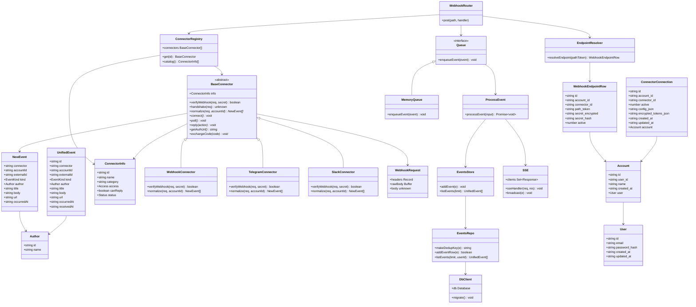

# Diagramme de classes - Fil Unifié

Ce document présente l'architecture orientée objet du projet : connecteurs, événements unifiés, webhooks, file, SSE, et persistance.

## Vue d'ensemble



## Détails des classes

### Types partagés (`shared/src/index.ts`)

| Classe/Type | Description |
|---|---|
| `UnifiedEvent` | Format commun à tous les connecteurs. Tous les événements dans le fil sont de ce type. |
| `NewEvent` | `UnifiedEvent` sans `id` et `receivedAt`. Produit par les connecteurs avant traitement. |
| `Author` | Auteur de l'événement (facultatif). |
| `EventKind` | Enum/type union: `message`, `mention`, `notification`, `task`, `other`. |
| `ConnectorInfo` | Informations affichées dans le catalogue client. |
| `Access` | `gratuit`, `conditionnel`, `payant`. |
| `Status` | `available`, `soon`. |

### Connecteurs (`server/src/connectors/`) 

| Classe | Description |
|---|---|
| `BaseConnector` (abstrait) | Classe mère. Définit l'interface commune. `verifyWebhook()`, `handshake()` ont des implémentations par défaut. `normalize()` est obligatoire. Ajoutera `connect()`, `poll()`, `reply()` plus tard. |
| `WebhookConnector` | Webhook générique. Vérifie `x-webhook-secret` via `timingSafeEqual. Normalise le JSON envoyé. |
| `TelegramConnector` | Webhook Telegram bot. Vérifie `x-telegram-bot-api-secret-token. Normalise `update.message.text`. |
| `SlackConnector** | Déjà exist, vérification & normalisation à adapter selon le contexte. |
| `ConnectorRegistry** | Registre central. Liste des connecteurs `available` plus catalogue `soon`. Permet `get()` et `catalog()`. |

### Webhooks & endpoints (`server/src/webhooks/`) 

| Classe/Fonction | Description |
|---d---|---|
| `WebhookRouter` | Routeur Express. À venir: `/webhooks/w/:path_token`. Actuellement `/webhooks/:connector/:accountId`. Résout l'endpoint, vérifie signature, gère handshake, normalise, enqueue. |
| `EndpointResolver` | Fonction de résolution: trouve l'endpoint actif via `path_token`. Récupère `connector_id, account_id, secret_encrypted. AP&D.R 2D.8R.90R.90.90:R.90:95;904</td></tr> <tr><td> `WebhookEndpointRow` </td><<td> Ligne SQL de la table `webhook_endpoints. </td></tr> </table>

### File, traitement & SSE (`server/src/queues/`, `server/src/sse/`) 

| Classe/Fonction | Description | Usage |
|---|---|------|`
| `Queue` interface | Abstraction pour basculer entre `MemoryQueue` et `BullMQQueue` sans changer le code. | Évolutivité |
| `MemoryQueue` (`enqueueEvent()`) | Implémentation mémoire actuelle. Utilise `setImmediate()` & `processEvent()`. | MVP actuel |
| `ProcessEvent` | Traite un `NewEvent`: génère `id`, `receivedAt`, ajoute au store, diffuse via `SSE`. | Cœur du traitement |
| `EventsStore` | Couche intermédiaire entre `ProcessEvent` & `EventsRepo`. Étend et purge au maximum 500. | Garde le code exist, adapté au repo pattern |
| `EventsRepo** | Accès SQL direct (better-sqlite3). Calcul `dedup_key`, gère doublons, filtres par utilisateur. | Persistance SQL |
| `SSE` (`sseHandler`, `broadcast`)) | Flux temps réel. Actuellement broadcast à tous les clients. **À adapter** pour isoler par utilisateur/compte dès auth. | Temps réel |

### Persistance (`server/src/db/`) 

| Classe/Fon&tion | Description | Usage |
|----|---|---|
| `DbClient** | Connexion `better-sqlite3`, dossier `data/`, migration au démarrage. | Singleton DB |
| `migrate()` | Système de migrations avec `schema_version`. Lance `schema.sql` si `current < 1. | Évolution schema |
| *Repos* | `events.repo.ts, `users.repo.ts, `accounts.repo.ts, `endpoints.repo.ts. | Repo pattern (isoler SQL)

### Authentification & comptes (`server/src/auth/`, `server/src/db/repos/`) 

| Classe/Fonction | Description | Usage | 
|---|---|---|
| `User** (Entité) | Utilisateur système. Stocké dans `users`. | Authentification | 
| `Account** (Entité) | Espace de travail/compte lié à un utilisateur. Stocké dans `accounts`. | Multi-comptes | 
| `ConnectorConnection** (Entité) | Connexion entre un `Account` et a connecteur. Tokens/config chiffrés dans `encrypted_tokens_json`. | Liaison app |
| `WebhookEndpointRow** (Entité) | Endpoint webhook actif. `path_token` UNIQUE, secret chiffré. | Webhook sécurisé |

## Diagramme de séquence - Webhook générique (flux actuel vs future)

### Flux actuel (en cours)
```mermaidi
sequenceDiagram
    participant Tierce as App Tierce
    participant Router as WebhooksRouter
    participant Conn as WebhookConnector
    participant Queue as Queue
    participant Proc as ProcessEvent
    participant Store as EventsStore
    participant SSE as SSE
    participant Client as Navigateur

    Tierce->>Router: POST /webhooks/webhook/:accountId + x-webhook-secret
    Router->>Conn: verifyWebhook(req, secret)
    Conn-->>Router: true
    Router->>Conn: normalize(req, accountId)
    Conn-->>Router: NewEvent[]
    Router->>Queue: enqueueEvent(event)
    Router-->>Tierce: 200 Accepted
    Queue->>Proc: processEvent(input)
    Proc->>Store: addEvent(event)
    Proc->>SSE: broadcast(event)
    SSE-->>Client: data: JSON</plug</Plug>
</plug>
```

### Flux futur (avec endpoint-resolver + idempotence)
```mermaid
sequenceDiagram
    participant Tierce as App Tierce
    participant Router as WebhooksRouter
    participant Resolver as EndpointResolver
    participant Conn as Connector
    participant RepoE as EventsRepo
    participant Queue as Queue
    participant Proc as ProcessEvent
    participant Store as EventsStore
    participant SSE as SSE
    participant Client as Navigateur

Tierce->>Router: POST /webhooks/w/:path_token + signature/header
    Router->>Resolver: resolveEndpoint(path_token)
    Resolver-->>Router: WebhookEndpointRow {account_id, connector_id, secret_encrypted}
    Router->>Conn: verifyWebhook(req, secret_decrypted)
    Conn-->>Router: true
    Router->>Conn: normalize(req, account_id)
    Conn-->>Router: NewEvent[]
    Router->>RepoE: makeDedupKey(event)
    RepoE-->>Router: dedup_key
    Router->>Proc: enqueueEvent(event + dedup_key)
    Router-->>Tierce: 200 Accepted
    Proc->>RepoE: addEventRow(event)
    RepoE-->>Proc: false / true (true si nouveau)
    Proc->>Store: addEvent(event) si nouveau
    Proc->>SSE: broadcast(event) si nouveau
    SSE--tag>Client: data: JSON
```

## Règles d'évolutivité
# PR Centripetal Force: Suspended Bodies on a Rotating Arm
 
  </div>
</template>

<script>
export default {
  # Method
  methods: {
    scrollToSection(sectionId) {
      const element = this $el.queryselector(sectionId);
      if (element) {
        class: "nav-link",
        click: () => this.scrollToSection('section1');
      },
    },
    generateLink(value, index) isnotnull() {
        (e) => <feBlend mode="Multiply" stdDeviation="4" /><use href="#path-1" />
  }
</script>
