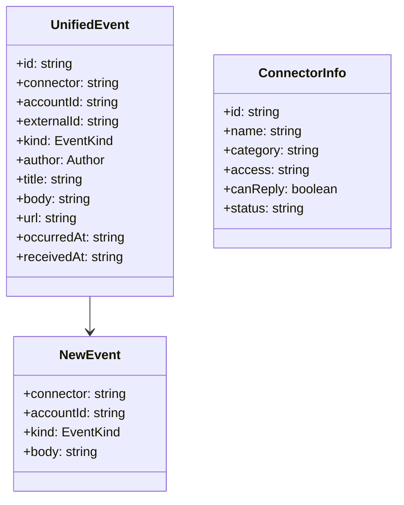
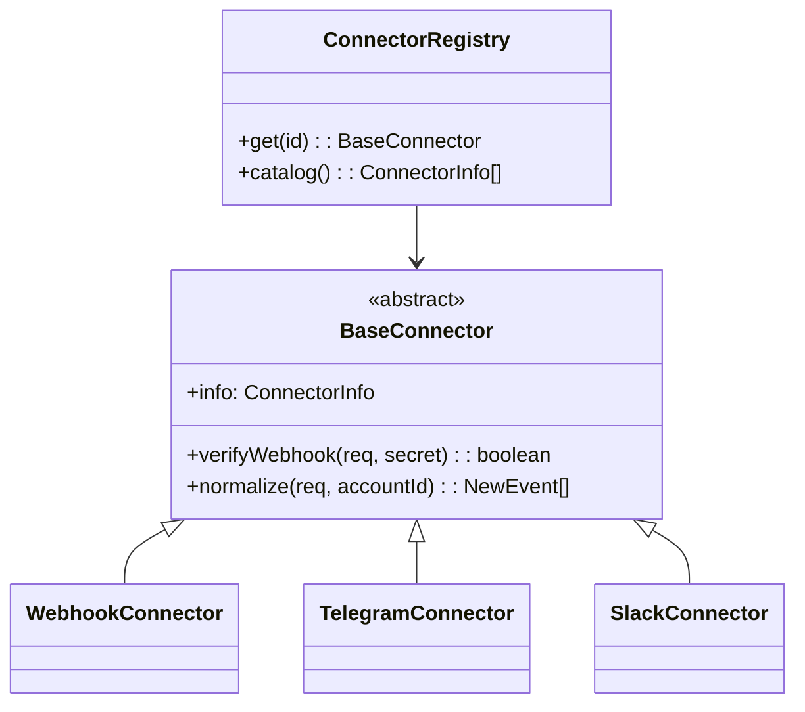
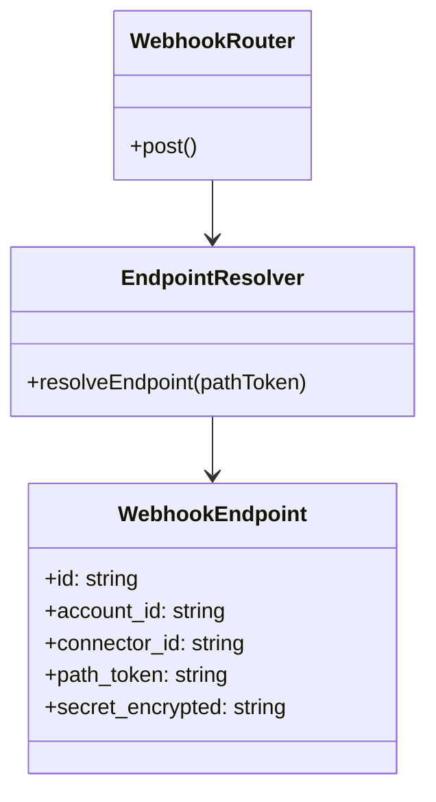
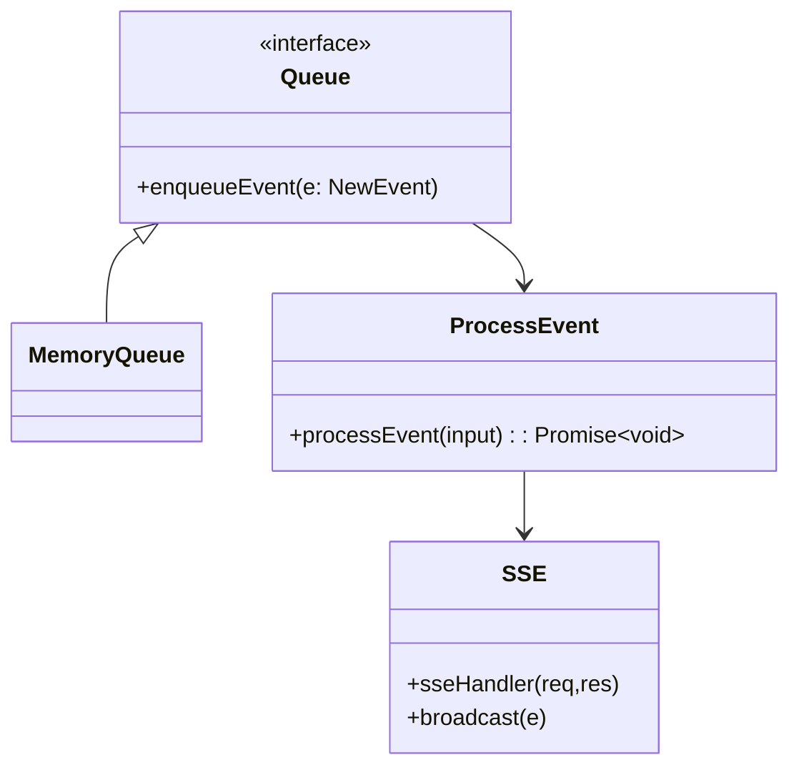
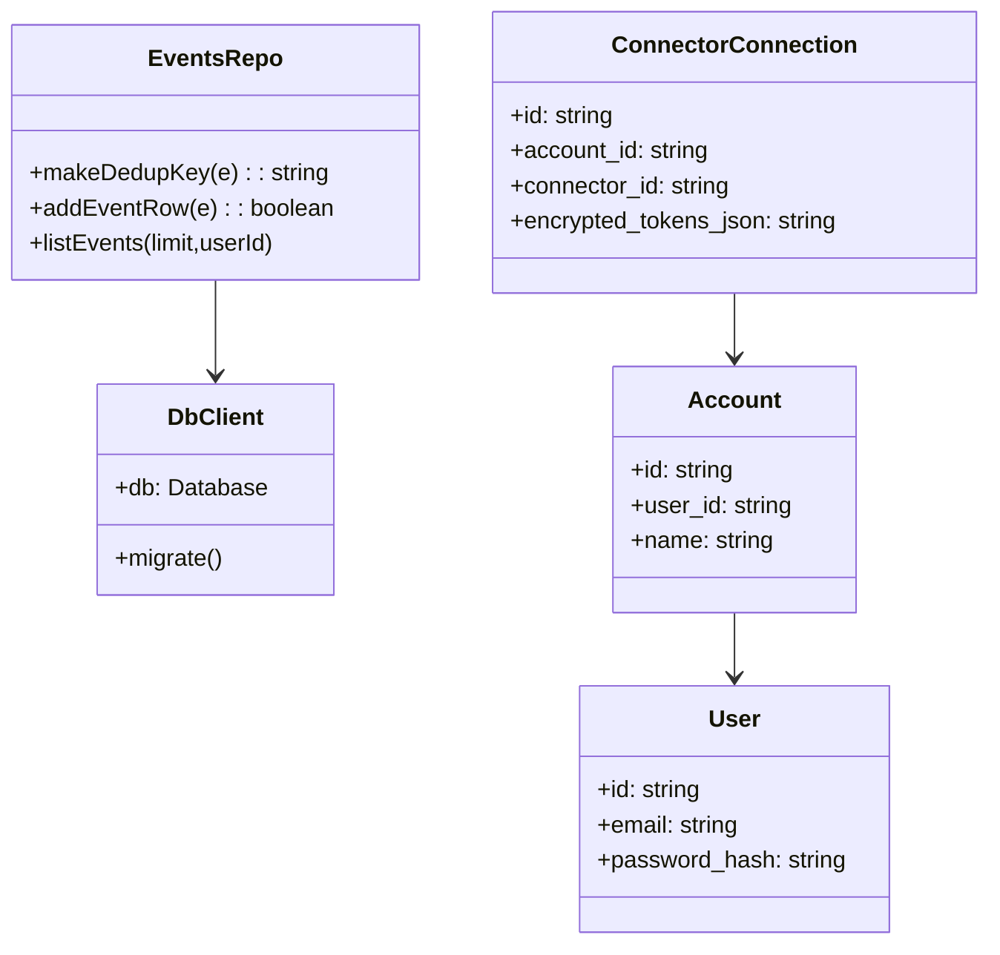
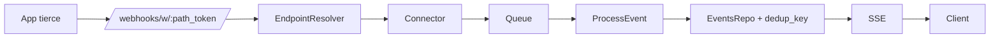

# Diagramme de classes léger - Fil Unifié

Pour une meilleure lisibilité dans Obsidian (Mermaid plus petit).

## 1) Types partagés

## 2) Connecteurs

## 3) Webhooks & endpoints

## 4) Traitement & temps réel

## 5) Persistance & comptes

## Flux simplifié

