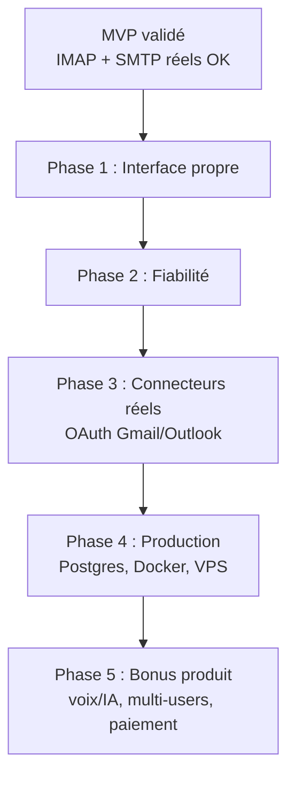
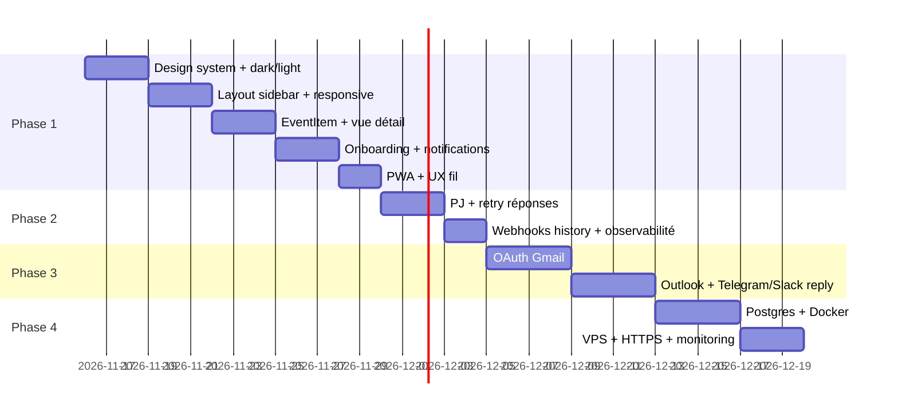

# Plan de l'application - Fil Unifié (post-MVP)

> Ce document décrit le **pipeline complet** pour transformer le MVP validé en application finie.
> Le MVP (auth, webhooks, IMAP réel, fil, réponses SMTP) est terminé et validé de bout en bout.
> Chaque phase a des **critères de validation** : on ne passe à la suivante que quand ils sont verts.

## Vue d'ensemble

## État actuel (dépôt propre, tout poussé sur `main`)

- [x] Auth sessions httpOnly + bcrypt + rate limiting
- [x] Webhooks sécurisés (jeton hashé SHA-256, secret AES-256-GCM, rotation, Telegram/Slack/générique)
- [x] Polling durable (backoff, sync_state/sync_runs) — IMAP multi-dossiers + pièces jointes, RSS
- [x] BullMQ/Redis + repli mémoire, DLQ, dashboard Bull Board (`/admin/queues`)
- [x] Fil : recherche, filtres, pagination curseur, non-lus, SSE temps réel
- [x] Réponses email SMTP (threading `In-Reply-To`/`References`) + historique `outbound_messages`
- [x] Sécurité : CORS strict, Zod par connecteur, SSE auth prod, erreurs IMAP lisibles
- [x] `33/33` tests vitest, typecheck + build client verts
- [x] **Validation réelle** : Gmail IMAP (9 dossiers) + réponse SMTP envoyée avec succès

---

## Phase 1 — Interface propre (priorité immédiate)

> **Statut : terminée** (sauf 1.4 groupement par thread, reporté en Phase 2).
> Fait : design system sombre/clair (accent indigo/violet), layout sidebar responsive,
> EventItem + vue détail modale + historique des réponses, onboarding wizard,
> notifications navigateur, filtres enregistrés, raccourcis clavier (j/k/Entrée/u), PWA installable.

Objectif : que l'application ressemble à un **produit**, pas à un prototype d'admin.

| Tâche | Fichier(s) | Détails |
|---|---|---|
| **1.1 Design system** | `client/src/index.css` | Variables CSS (`--bg`, `--fg`, `--accent`…), composants réutilisables (Bouton, Carte, Badge, Input, EmptyState), dark/light mode avec bascule persistée (localStorage). |
| **1.2 Layout avec sidebar** | `client/src/App.tsx` + `Layout.tsx` (nouveau) | Sidebar fixe : Fil / Applications / Connexions / Réglages. Header avec email utilisateur, badge non-lus, bouton déconnexion. Responsive : sidebar → barre basse sur mobile. |
| **1.3 Carte événement** | `client/src/components/EventItem.tsx` (nouveau) | Carte propre : icône par connecteur, auteur, date relative, corps tronqué avec « Voir plus », vue détail (plein écran/modal) avec pièces jointes + historique des réponses. |
| **1.4 Groupement par thread** | `client/src/components/Feed.tsx` | Regrouper les emails d'une même conversation (`threadKey`/`References`), badge « 3 messages ». |
| **1.5 Onboarding wizard** | `client/src/components/Onboarding.tsx` (nouveau) | Après inscription : pas-à-pas « Ajouter une boîte mail » (IMAP + lien mot de passe d'application Google) ou « Ajouter un webhook ». Skip possible. |
| **1.6 Notifications navigateur** | `client/src/notifications.ts` (nouveau) | Demande de permission, Notification API quand un événement SSE arrive et que l'onglet est en arrière-plan, son optionnel. |
| **1.7 UX fil** | `Feed.tsx` | Filtres enregistrés (localStorage), raccourcis clavier (j/k lu/suivant), « marquer tout lu » par connexion. |
| **1.8 PWA** | `client/vite.config.ts` + manifest | `vite-plugin-pwa` : manifest, service worker, installable sur mobile. |

**Critère de validation :** l'interface est agréable sur desktop ET mobile, un nouvel utilisateur comprend comment ajouter sa boîte mail sans explication, dark/light fonctionne, les notifications arrivent.

## Phase 2 — Fiabilité (après interface)

> **Statut : terminée.** Téléchargement des PJ à la demande (`GET /api/events/:id/attachments/:index`,
> fetch IMAP par UID/Message-ID), retry automatique des réponses (3 essais max, worker 3 min),
> curseur par dossier IMAP (`sync_state` par ressource), historique des livraisons webhook
> (`webhook_deliveries` v9 + UI « Historique des réceptions »).

| Tâche | Détails |
|---|---|
| **2.1 Téléchargement PJ** | Route `GET /api/events/:id/attachments/:attId` : fetch IMAP à la demande + streaming authentifié. |
| **2.2 Retry des réponses** | Worker BullMQ sur `outbound_messages` (`pending`) : retry avec backoff, statut `failed` final + notification UI. |
| **2.3 Curseur par dossier** | `sync_state` par ressource (un curseur par dossier IMAP, pas global) pour reprendre où on s'est arrêté. |
| **2.4 Historique webhooks** | Table `webhook_deliveries` : chaque POST webhook reçu (statut, erreur), consultable dans l'UI Connexions. |
| **2.5 Observabilité** | Logs structurés (JSON), alerting DLQ (page Réglages : compteur + bouton rejouer), métriques simples (compteur par connecteur). |

**Critère de validation :** une réponse qui échoue (SMTP coupé) est retentée puis marquée `failed` avec cause visible ; on peut télécharger une PJ ; l'historique webhook se voit dans l'UI.

## Phase 3 — Connecteurs réels

| Tâche | Détails |
|---|---|
| **3.1 OAuth Gmail** | `oauth_states` (state nonce CSRF), `getAuthUrl()`/`exchangeCode()`, refresh tokens chiffrés, route `/auth/oauth/:connector/callback`. Nécessite un projet Google Cloud + identifiants OAuth. |
| **3.2 OAuth Outlook** | Même socle, Azure AD app registration. |
| **3.3 Réponses Telegram/Slack** | `reply()` de ces connecteurs (envoi dans le chat d'origine), bouton « Répondre » actif pour leurs événements. |
| **3.4 Google Calendar** | Connecteur polling API v3 ( OAuth de 3.1). |
| **3.5 Catalogue d'apps** | Page « Applications » : cartes par connecteur avec statut (connecté/pas connecté), + `app_wishes` (liste de souhaits votables). |

**Critère de validation :** on ajoute Gmail par OAuth (aucun mot de passe d'application à saisir), on répond à un message Telegram depuis le fil.

## Phase 4 — Production

| Tâche | Détails |
|---|---|
| **4.1 PostgreSQL** | Remplacer better-sqlite3 par `pg` : les repos sont déjà isolés, adapter le SQL (types, `RETURNING`). Migrations idempotentes. |
| **4.2 Docker** | `Dockerfile` server + client, `docker-compose.yml` (server, client, redis, postgres), `.env.production.example`. |
| **4.3 Hébergement** | VPS + HTTPS (Caddy ou nginx + certbot), domaine, systemd ou compose en `restart: always`. |
| **4.4 Sécurité prod** | Reset password (email), `audit_log` (connexions, rotations), rotation sessions, sauvegardes DB (cron `sqlite3 .backup` ou `pg_dump`). |
| **4.5 Monitoring** | Sentry (client + server) ou logs agrégés, uptime monitor. |

**Critère de validation :** l'app tourne sur un domaine HTTPS, un redémarrage machine la remet d'aplomb, sauvegarde DB quotidienne vérifiée.

## Phase 5 — Bonus produit (ordre au choix)

- **Voix/IA** : transcription audio (Groq Whisper), TTS, résumé des non-lus, brouillon de réponse IA.
- **Multi-utilisateurs par espace** : table `account_members` (rôles owner/member), invitations.
- **Abonnements** : si SaaS — Stripe, plan free/pro (limites : nb connexions, rétention).
- **Integrations natives** : Discord, Microsoft Teams, WhatsApp.

---

## Ordre de travail recommandé

> Les durées sont indicatives. On avance phase par phase, avec commit + push à chaque étape validée (l'utilisateur demande avant chaque push).
